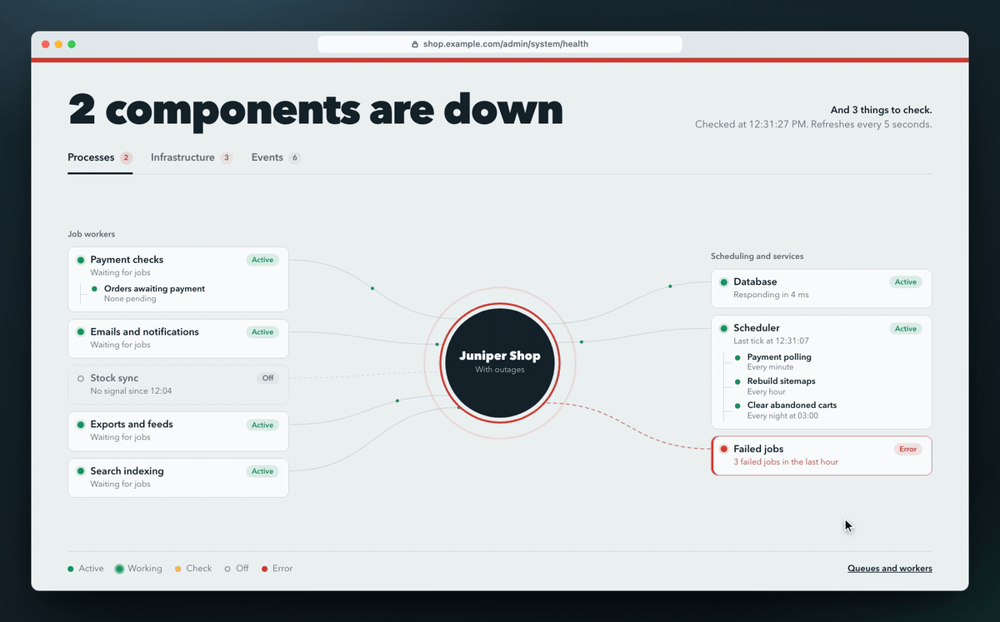
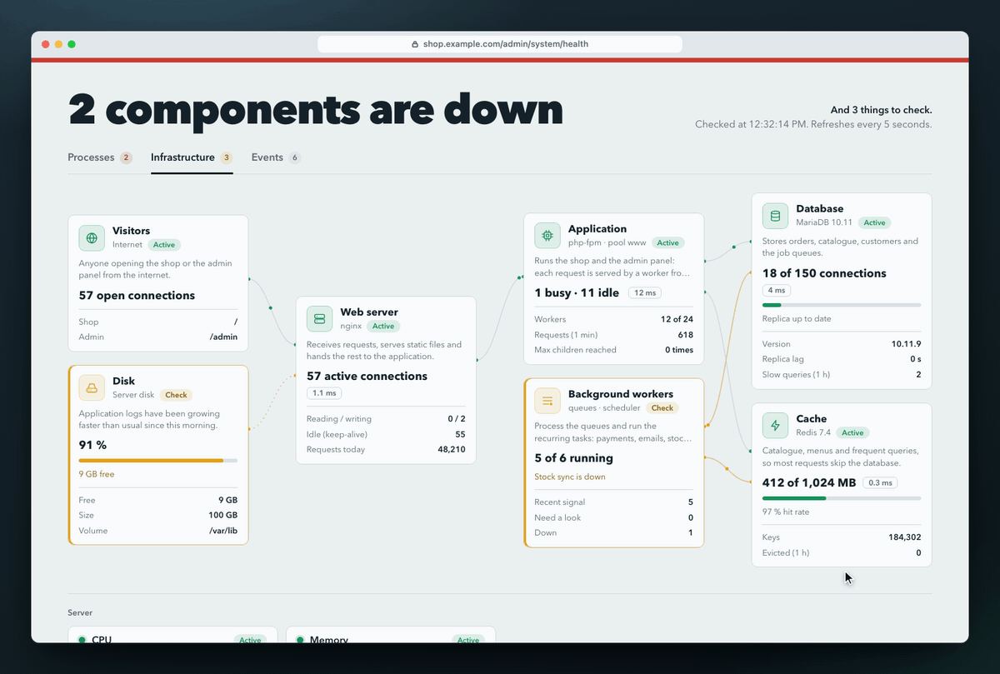
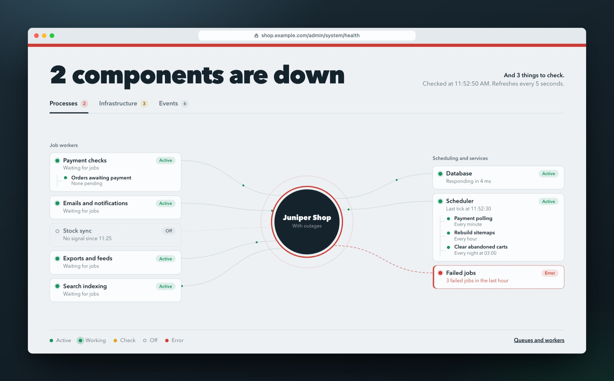
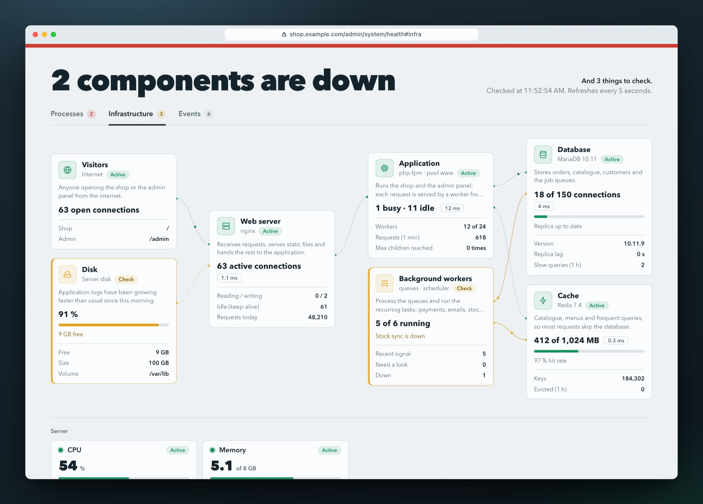
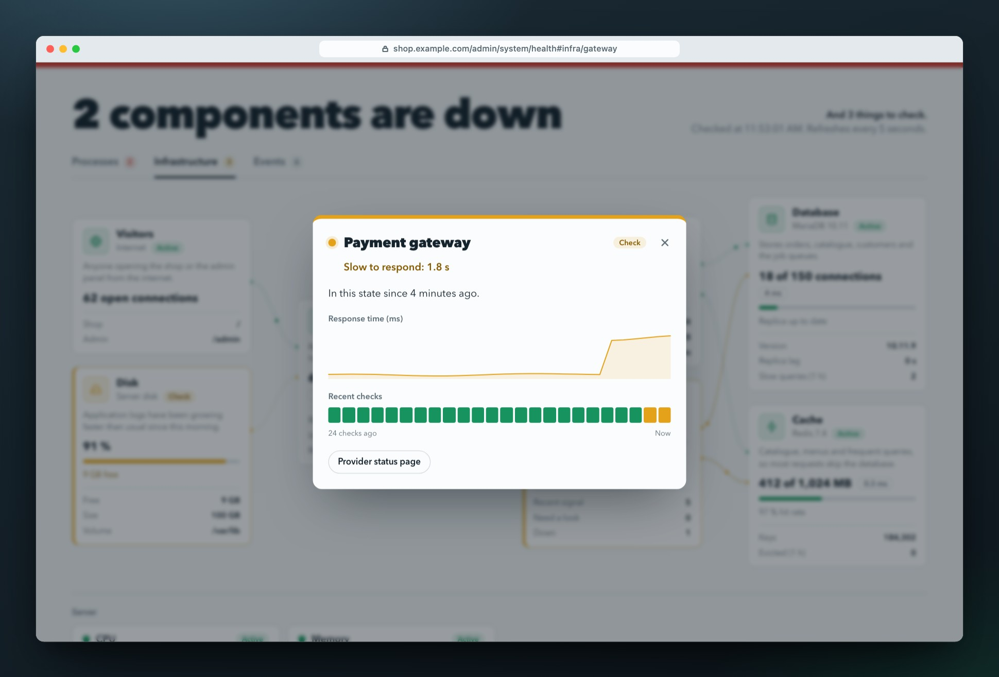
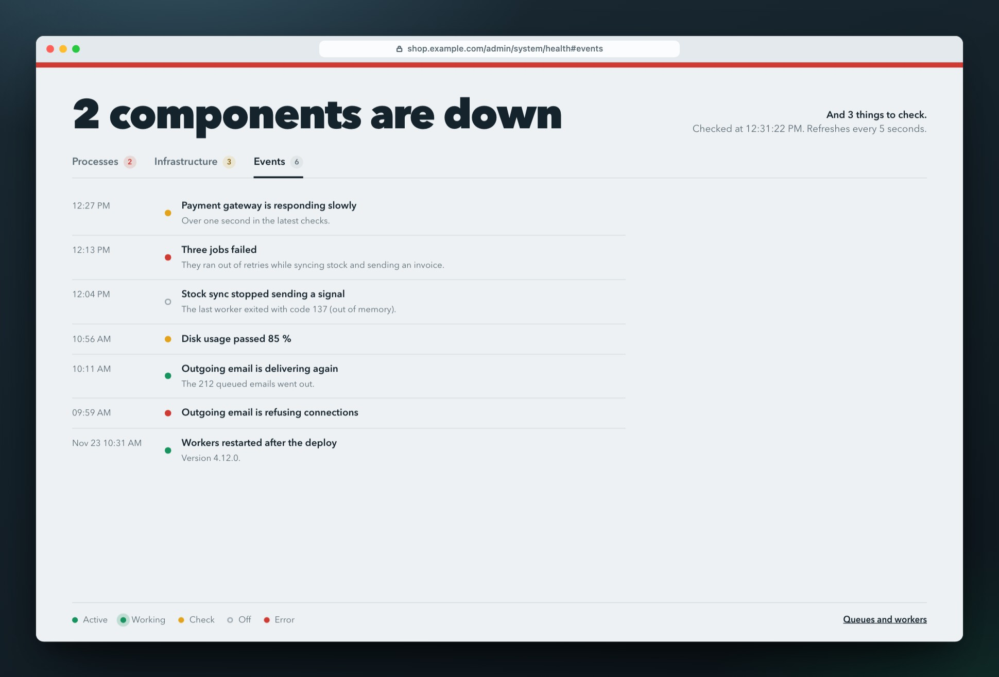
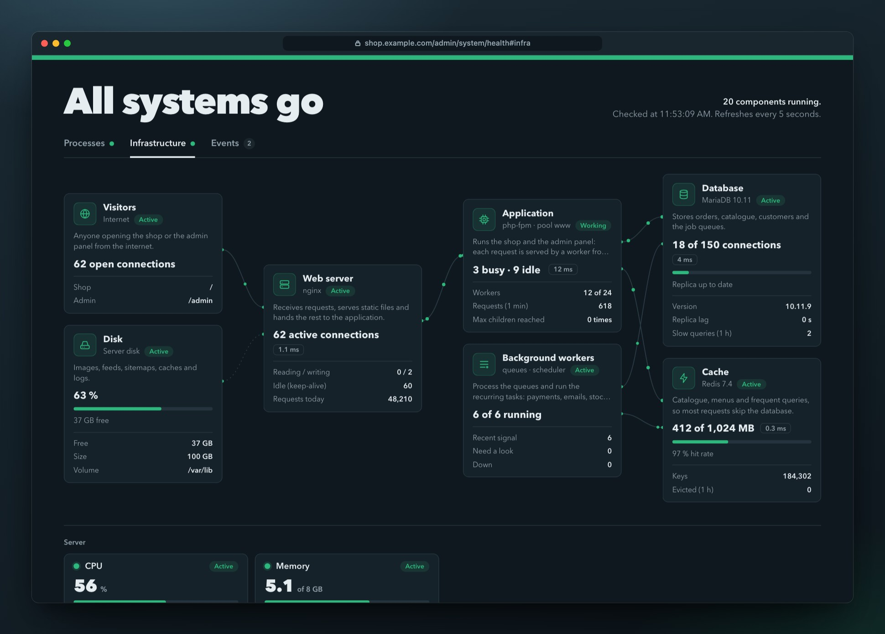
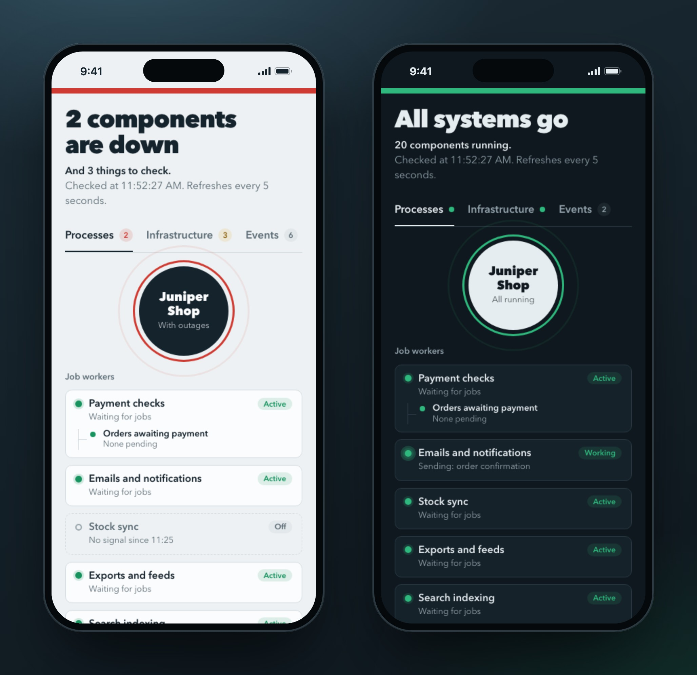
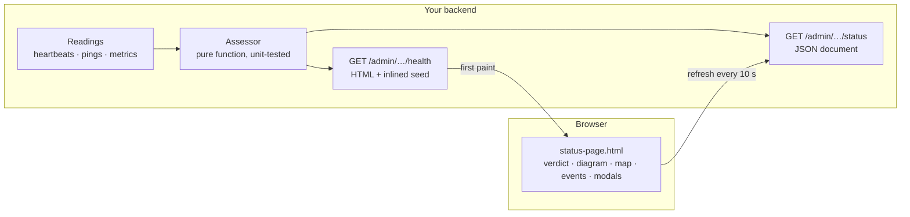

<div align="center">

# Pulso

**Status pages you can read at a glance.**

A [Claude Code](https://claude.com/claude-code) skill that gives any web project a
full-screen system status page: workers, queues, cron, databases and external services,
wired to your real backend and covered by tests.

[](https://skills.sh/josAlba/pulso-status-skill)
[](LICENSE)
[](skills/pulso/assets/status-page.html)
[](skills/pulso/references/adapters.md)

[Install](#install) · [Features](#features) · [Live demo](#try-the-demo) · [How it works](#how-it-works) · [Data contract](#data-contract)

<br>



</div>

## Why Pulso

Most health endpoints answer a machine. Pulso answers a person: **"Is everything
working?"**, in one sentence big enough to read from across the room, with the detail one
click away.

Ask Claude for a status page and the skill takes it from there. It inventories what
actually runs in your project, puts the status rules in a small tested function in your
backend, and connects a ready-made page that has already been designed, tested and
made accessible. The page itself is a single HTML file with no dependencies, so it fits
Symfony, Laravel, Django, Rails, Express, Next.js, Go or anything else that can serve
JSON.

## Install

With [skills.sh](https://skills.sh), from your project folder:

```bash
npx skills add josAlba/pulso-status-skill --skill pulso -a claude-code
```

Add `-g` to install it for every project (in `~/.claude/skills/pulso`):

```bash
npx skills add josAlba/pulso-status-skill --skill pulso -a claude-code -g
```

Requires Node 22.20+. Leave out `-a claude-code` to pick other agents (Codex, Cursor…).
Prefer git or the plugin system? See [other ways to install](#other-ways-to-install).

## Usage

In Claude Code, inside your project:

> Build a system status page in the admin area with the workers, the cron jobs, the database and the payment gateway.

> I want something like /system/health for this project.

Claude loads the skill and follows its workflow:

1. **Inventory** the workers, queues, schedulers, datastores and services that really run, and confirm the list with you.
2. **Decide each status in the backend**: thresholds, timeouts and plain-language messages, in a pure assessor with unit tests.
3. **Expose two admin-only routes**: the page (with the first reading inlined) and the JSON it refreshes from.
4. **Adapt the template** to your brand and language, without touching the parts that make it work.
5. **Verify every state** in a browser: healthy, warning, down, offline, expired session, mobile and reduced motion.

## Features



- **A verdict first.** "All systems go", "One thing needs a look", "2 components are down".
  The top strip, the favicon and the tab title change colour together, so the state shows
  even from a background tab.
- **Processes that look alive.** Workers sit in two lanes around a core, joined by wires
  that carry signals: fast when a component is busy, slow when it needs a look, none when
  it is down.
- **An infrastructure map.** The path a request takes (visitors → web server → application
  → database and cache) with live wires, followed by grouped cards with gauges and trends
  for CPU, memory and external services.
- **An event timeline** of recent state changes, each linked to its component.
- **Linkable detail modals.** Description, time in the current state, a strip of recent
  checks, an enlarged trend, facts and runbook links. Every modal has its own URL
  (`#processes/stock`) to paste into a chat during an incident.
- **Honest about failure.** Clear banners when the endpoint is unreachable, the session
  expires or the data goes stale.
- **Built for everyone.** Dark mode, mobile layout, full keyboard navigation, a native
  `<dialog>`, status never shown by colour alone, and `prefers-reduced-motion` respected.
- **English and Spanish built in**, chosen with `<html lang>`; adding a language is one
  dictionary.
- **Zero dependencies.** One HTML file with plain CSS and JavaScript that renders a JSON document.

### Gallery

<table>
  <tr>
    <td width="50%"></td>
    <td width="50%"></td>
  </tr>
  <tr>
    <td align="center"><sub><b>Processes</b> · workers and services around the core</sub></td>
    <td align="center"><sub><b>Infrastructure map</b> · the path of a request, with live wires</sub></td>
  </tr>
  <tr>
    <td width="50%"></td>
    <td width="50%"></td>
  </tr>
  <tr>
    <td align="center"><sub><b>Trends</b> · when a service started to degrade</sub></td>
    <td align="center"><sub><b>Events</b> · what changed, and when</sub></td>
  </tr>
  <tr>
    <td width="50%"></td>
    <td width="50%"></td>
  </tr>
  <tr>
    <td align="center"><sub><b>Dark mode</b> · automatic, or forced for wall screens</sub></td>
    <td align="center"><sub><b>Mobile</b> · a single column, same information</sub></td>
  </tr>
</table>

## Try the demo

No install needed, just Node 18+:

```bash
node skills/pulso/scripts/demo-server.mjs
```

Open <http://localhost:4173>. The fictional shop's data changes on its own every few
seconds. Other views:

| URL | Shows |
|---|---|
| `/?scenario=ok` | Everything healthy |
| `/?scenario=ko` | A stopped worker, failed jobs, a nearly full disk and a slow gateway |
| `/?scenario=live` | States that change over time (default) |
| `/?scenario=empty` | Nothing to watch yet |
| `/?theme=dark` | Forces dark mode (combines with the above) |
| `/?lang=es` | Spanish interface |
| `#infra/gateway` | Opens a tab and a modal directly |

To preview your own template and data:

```bash
node skills/pulso/scripts/demo-server.mjs --template path/to/template.html --data path/to/status.json
```

## How it works



The logic lives on the server; the page only paints. That is why the same HTML works with
any stack, and why the part that matters (when something counts as down or worth a look)
is covered by tests in your project's own language.

## Data contract

A trimmed example. The full reference is in
[`skills/pulso/references/data-contract.md`](skills/pulso/references/data-contract.md).

```json
{
  "service": "Juniper Shop",
  "checkedAt": "2026-11-23T17:00:33+01:00",
  "lanes": [{"key": "workers", "label": "Job workers", "side": "left"}],
  "nodes": [
    {"key": "stock", "label": "Stock sync", "status": "off",
     "detail": "No signal since 16:42", "lane": "workers",
     "history": ["active", "active", "off"], "facts": {"Queue": "stock"}},
    {"key": "disk", "tab": "infra", "group": "Server", "label": "Disk", "status": "attention",
     "detail": "9 GB free", "gauge": {"value": 91, "max": 100, "unit": "%"}}
  ],
  "events": [{"at": "2026-11-23T16:42:00+01:00", "status": "off", "title": "Stock sync stopped sending a signal", "node": "stock"}]
}
```

For the infrastructure map, each component lists what it calls:

```json
{"key": "app", "tab": "infra", "icon": "cpu", "label": "Application", "meta": "php-fpm · pool www",
 "status": "active", "value": "3 busy · 9 idle", "tag": "12 ms",
 "connects": ["db", "cache", {"to": "disk", "passive": true}]}
```

| Status | Meaning |
|---|---|
| `active` | Working, with a recent signal |
| `working` | Working and busy right now |
| `attention` | Still working, but something needs a look |
| `off` | Stopped or silent |
| `error` | The last run or check failed |

## Framework support

The template is engine-agnostic (no `{{`, `{%` or `<%` inside), and the skill ships
adapter examples for:

| Stack | Page and JSON routes | Seed escaping |
|---|---|---|
| Symfony | Controller + Twig, `#[IsGranted]` | `json_encode` with `JSON_HEX_TAG` |
| Laravel | Route group + Blade, `can:admin` | `json_encode` with `JSON_HEX_TAG` |
| Django | Views + `json_script` | built in |
| Rails | Controller + ERB | `json_escape` |
| Express / Node | Two handlers, string replace | `<` |
| Next.js | Route handlers (App Router) | `<` |
| Go | `net/http` + `embed` | `json.Marshal` |

Details in [`skills/pulso/references/adapters.md`](skills/pulso/references/adapters.md).

## Other ways to install

**From a clone, for every project.** Symlinks the skill into `~/.claude/skills/pulso`, so
`git pull` keeps it current (`--copy` copies it instead):

```bash
git clone https://github.com/josAlba/pulso-status-skill.git ~/Documents/GitHub/pulso-status-skill
```

```bash
~/Documents/GitHub/pulso-status-skill/scripts/install.sh
```

**Into one project, to share it with the team.** Leaves the skill in
`/path/to/project/.claude/skills/pulso`, ready to commit:

```bash
./scripts/install.sh --copy /path/to/project
```

**As a Claude Code plugin.** The repository is also a plugin and a marketplace:

```text
/plugin marketplace add josAlba/pulso-status-skill
/plugin install pulso@pulso
```

## Repository layout

```
pulso-status-skill/
├── skills/pulso/                 ← the skill (this is what gets installed)
│   ├── SKILL.md                  workflow, rules and definition of done
│   ├── assets/status-page.html   self-contained template
│   ├── scripts/demo-server.mjs   demo and reference Node adapter
│   └── references/
│       ├── data-contract.md      the JSON contract
│       ├── collectors.md         what to watch and how to decide each status
│       ├── adapters.md           Symfony, Laravel, Django, Express, Next.js, Rails, Go
│       └── design.md             visual system and how to adapt it
├── .claude-plugin/               plugin and marketplace manifests
├── scripts/
│   ├── install.sh                installs the skill from a clone
│   └── screenshots.mjs           regenerates the README images
└── docs/screenshots/
```

## Regenerating the images

```bash
node scripts/screenshots.mjs
```

Drives Chrome over the DevTools protocol against the demo server, frames each view and
writes `docs/screenshots/`. The animated tours drive the real page with a visible cursor,
clicking components to open their modals. Pass names (`hero`, `dark`, `mobile`,
`tour-processes`, `tour-infrastructure`…) to rebuild only some. Needs Node 22+, Chrome or
Chromium (`CHROME=/path/to/chrome` if it isn't found) and ffmpeg for the tours.

## Background

Pulso grew out of the `/backoffice/system/health` page of a Symfony e-commerce site: the
process diagram around a core, the big verdict and the signals running along the wires
come from there. The skill adds the infrastructure map, events, modals, dark mode,
translations and framework independence.

## License

[MIT](LICENSE) © josAlba
