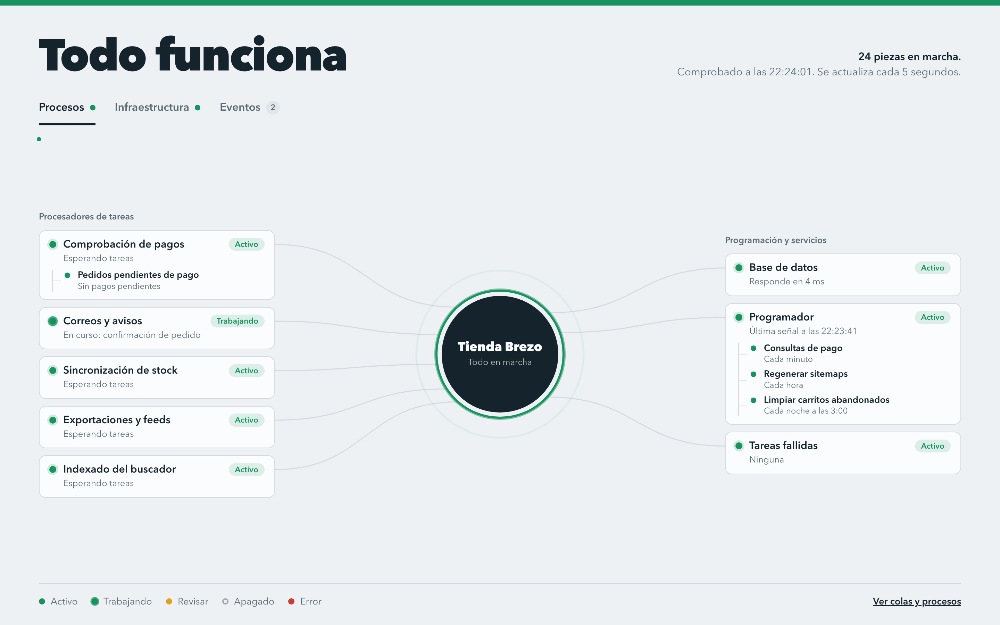
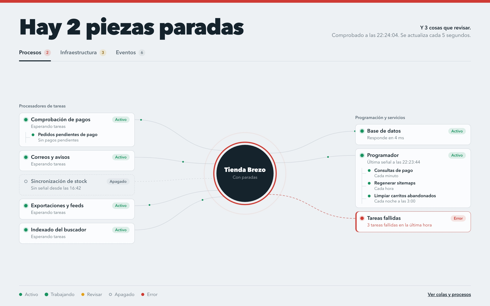
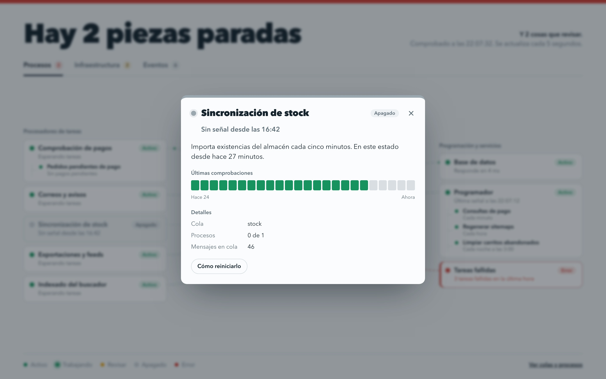
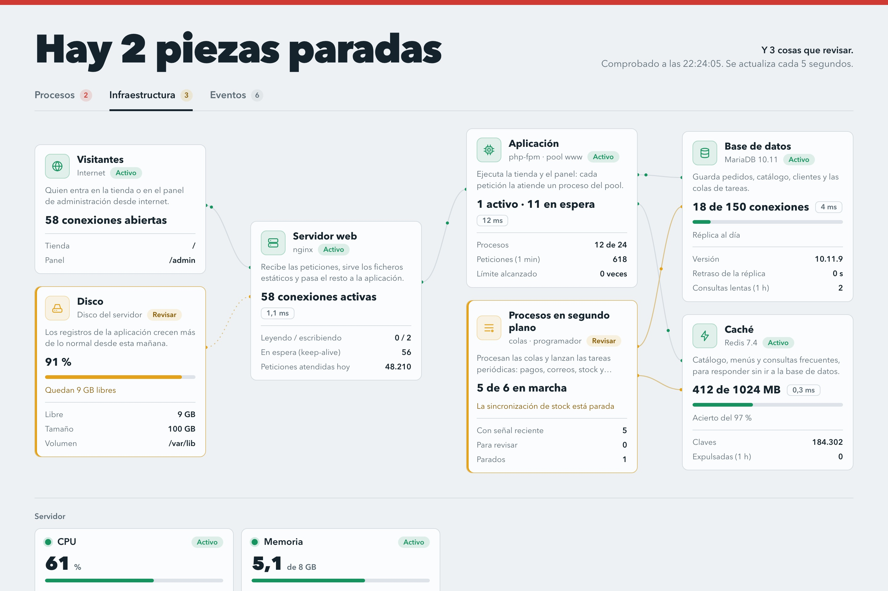
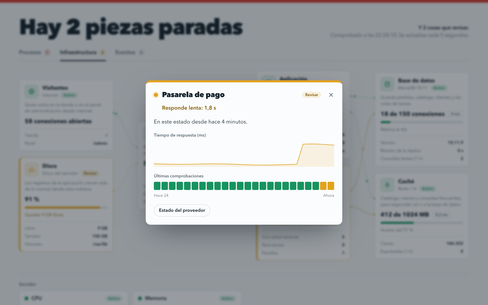
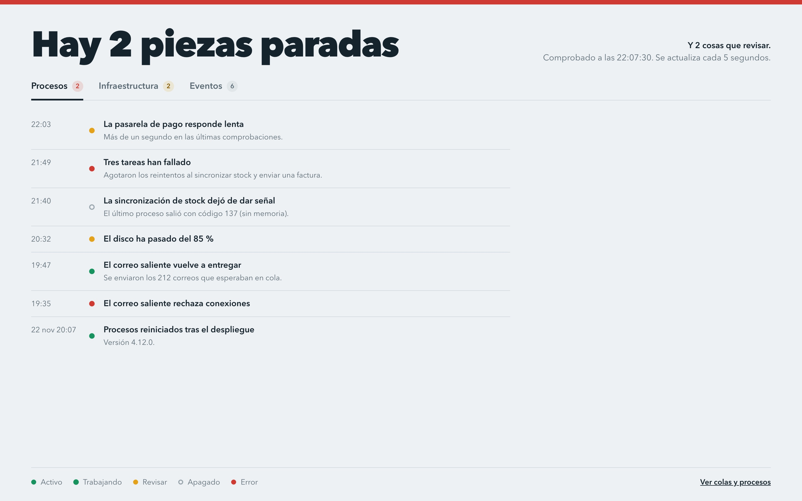
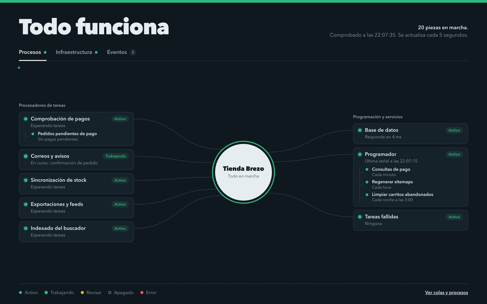
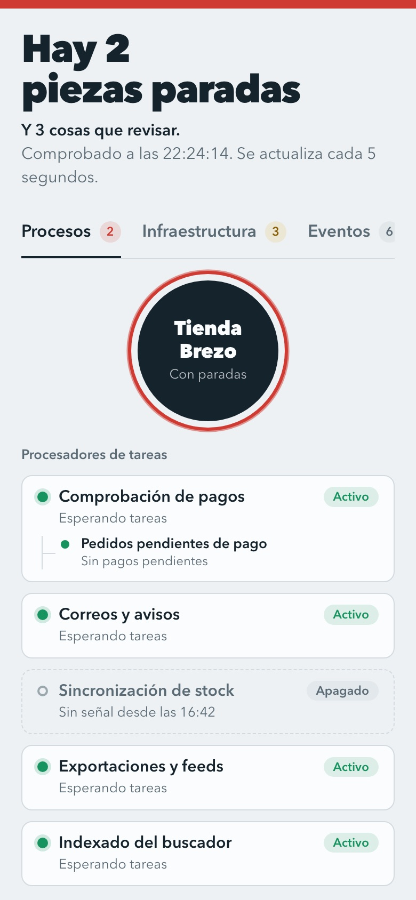

# Pulso

**Una skill para Claude Code que crea páginas de estado del sistema que se entienden de un vistazo.**

Pídele a Claude «hazme una página de estado» en cualquier proyecto (Symfony, Laravel,
Django, Rails, Express, Next.js, Go…). Con esta skill, Claude hace inventario de lo
que corre de verdad (workers, colas, cron, base de datos, caché, servicios externos),
decide cómo se calcula cada estado en el backend y conecta una página a pantalla
completa ya diseñada y probada.



## Qué incluye la página

- **Veredicto en grande**: «Todo funciona», «Hay una cosa que revisar», «Hay 2 piezas
  paradas». La franja superior, el favicon y el título de la pestaña cambian de color
  a la vez, así que el estado se ve aunque la pestaña esté en segundo plano.
- **Procesos**: esquema con un núcleo al centro y las piezas en dos carriles,
  unidas por cables por los que circulan señales. Las señales son rápidas si la pieza
  está trabajando, lentas si hay que revisarla y no aparecen si está parada.
- **Infraestructura**: tarjetas agrupadas con cifra, medidor y tendencia (base de datos,
  caché, disco, CPU, memoria, servicios externos).
- **Eventos**: línea de tiempo con los cambios de estado recientes.
- **Modales de detalle** para cualquier pieza: descripción, desde cuándo está así, tira
  de las últimas comprobaciones, tendencia ampliada, datos y enlaces (runbooks, logs).
  Cada modal tiene su propia URL (`#procesos/stock`) para compartirlo.
- **Refresco automático** sin recargar, con avisos claros si se pierde la conexión, si
  caduca la sesión o si los datos se quedan viejos.
- **Modo oscuro**, diseño adaptado a móvil, navegación por teclado y respeto por
  `prefers-reduced-motion`.
- **Sin dependencias**: un único HTML con CSS y JavaScript nativos que consume un JSON.

| Algo falla | Detalle de una pieza |
|---|---|
|  |  |
| **Infraestructura** | **Detalle con tendencia** |
|  |  |
| **Eventos** | **Modo oscuro** |
|  |  |

<p align="center"></p>

## Pruébala en 10 segundos

Necesitas Node 18 o posterior.

```bash
node skills/pulso/scripts/demo-server.mjs
```

Abre <http://localhost:4173>. Los datos de la tienda ficticia cambian solos cada pocos
segundos. Otros escenarios:

| URL | Muestra |
|---|---|
| `/?scenario=ok` | Todo funciona |
| `/?scenario=ko` | Un proceso parado, tareas fallidas, disco casi lleno y pasarela lenta |
| `/?scenario=live` | Estados que cambian con el tiempo (por defecto) |
| `/?scenario=empty` | Sin piezas que vigilar |
| `/?theme=dark` | Fuerza el modo oscuro (se combina con los anteriores) |
| `#infra/gateway` | Abre directamente una pestaña y un modal |

## Instalación

### Como skill personal (todos tus proyectos)

```bash
git clone https://github.com/josAlba/pulso-status-skill.git ~/Documents/GitHub/pulso-status-skill
```

```bash
~/Documents/GitHub/pulso-status-skill/scripts/instalar.sh
```

Crea un enlace simbólico en `~/.claude/skills/pulso`, así que un `git pull` la mantiene al
día. Con `--copiar` hace una copia en lugar del enlace.

### En un proyecto concreto (para compartirla con el equipo)

```bash
./scripts/instalar.sh --copiar /ruta/al/proyecto
```

Deja la skill en `/ruta/al/proyecto/.claude/skills/pulso` para versionarla con el proyecto.

### Como plugin

El repositorio también es un plugin y un marketplace de Claude Code
(`.claude-plugin/`):

```text
/plugin marketplace add josAlba/pulso-status-skill
/plugin install pulso@pulso
```

## Uso

En Claude Code, dentro de tu proyecto:

> Hazme una página de estado del sistema en el backoffice con los workers, el cron, la base de datos y la pasarela de pago.

> Quiero algo como /system/health para este proyecto.

Claude carga la skill y sigue su flujo: inventario de piezas, reglas de estado en el
backend con tests, dos rutas protegidas (HTML y JSON), adaptación de la plantilla a la
marca y verificación de todos los estados.

## Cómo funciona

```
 backend                                   navegador
┌───────────────────────┐   semilla JSON  ┌──────────────────────────┐
│ evaluador (puro, con  │ ──────────────▶ │ status-page.html         │
│ tests): lecturas →    │                 │ pinta veredicto, esquema,│
│ documento del contrato│ ◀────────────── │ infra, eventos y modales │
└───────────────────────┘  GET cada 10 s  └──────────────────────────┘
```

La lógica vive en el servidor; la página solo pinta. Así el mismo HTML sirve para
cualquier stack, y lo que importa (cuándo algo está parado o hay que revisarlo) queda
cubierto por tests en el lenguaje del proyecto.

## Estructura

```
pulso-status-skill/
├── skills/pulso/                 ← la skill (esto es lo que se instala)
│   ├── SKILL.md                  flujo de trabajo y reglas
│   ├── assets/status-page.html   plantilla autocontenida
│   ├── scripts/demo-server.mjs   demo y adaptador de referencia en Node
│   └── references/
│       ├── data-contract.md      contrato JSON
│       ├── collectors.md         qué vigilar y cómo decidir cada estado
│       ├── adapters.md           Symfony, Laravel, Django, Express, Next.js, Rails, Go
│       └── design.md             sistema visual y cómo adaptarlo
├── .claude-plugin/               manifiestos de plugin y marketplace
├── scripts/
│   ├── instalar.sh               instala la skill
│   └── capturas.sh               regenera las capturas de este README
└── docs/screenshots/
```

## Contrato de datos, en resumen

```json
{
  "service": "Tienda Brezo",
  "checkedAt": "2026-11-23T17:00:33+01:00",
  "lanes": [{"key": "workers", "label": "Procesadores de tareas", "side": "left"}],
  "nodes": [
    {"key": "stock", "label": "Sincronización de stock", "status": "off",
     "detail": "Sin señal desde las 16:42", "lane": "workers",
     "history": ["active", "active", "off"], "facts": {"Cola": "stock"}},
    {"key": "disk", "tab": "infra", "group": "Datos", "label": "Disco", "status": "attention",
     "detail": "Quedan 9 GB libres", "gauge": {"value": 91, "max": 100, "unit": "%"}}
  ],
  "events": [{"at": "2026-11-23T16:42:00+01:00", "status": "off", "title": "La sincronización de stock dejó de dar señal", "node": "stock"}]
}
```

Estados: `active`, `working`, `attention`, `off` y `error`. La referencia completa está en
[`skills/pulso/references/data-contract.md`](skills/pulso/references/data-contract.md).

## Capturas

```bash
./scripts/capturas.sh
```

Regenera `docs/screenshots/` con el servidor de demo y Google Chrome sin interfaz
(macOS; en otros sistemas indica el binario con `CHROME=/ruta/a/chrome`).

## Origen

Pulso nace de generalizar la página `/backoffice/system/health` de un ecommerce en
Symfony: el esquema de procesos alrededor de un núcleo, el veredicto en grande y las
señales que circulan por los cables vienen de ahí. La skill añade las pestañas de
infraestructura y eventos, los modales, el modo oscuro y la independencia del framework.
